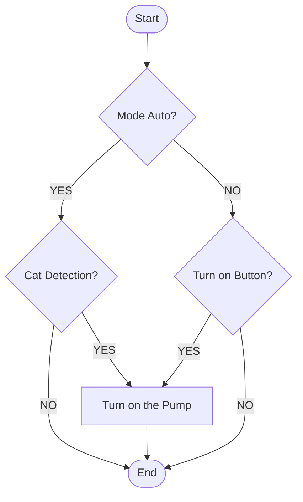
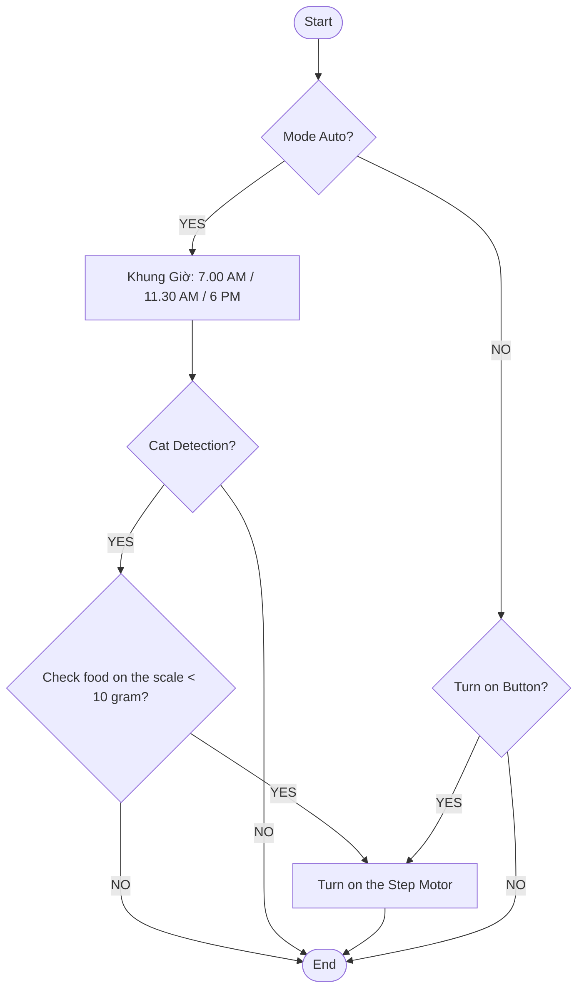

# 3.5 Thiết Kế Trang Web Quản Lý và Theo Dõi (AuraPet AIoT)

> **Cập nhật kiến trúc**: Thay thế vi máy tính trung tâm từ **Raspberry Pi 3B+** sang **Raspberry Pi 4 Model B**, phối hợp cùng vi điều khiển **ESP32**, dịch vụ đám mây thời gian thực **Firebase Realtime Database**, máy chủ ứng dụng **Spring Boot**, và lưu trữ dữ liệu bền vững trên **MariaDB (quản lý trực quan bằng HeidiSQL)**.

---

## 1. Mô Tả Tổng Quan Hệ Thống

**Raspberry Pi 4** đóng vai trò là trung tâm điều khiển (IoT Edge Gateway Hub) trong hệ sinh thái liên kết giữa **ESP32**, **Firebase Realtime Database**, máy chủ dịch vụ và **Trang web quản lý**.

```
┌─────────────────────────────────────────────────────────────────────────────┐
│                           Trang Web Quản Lý (Web UI)                        │
│             - Giám sát mức hạt & nước thời gian thực                        │
│             - Điều khiển Auto, Btn Led, Machines (Nhả hạt/Bơm nước)         │
│             - Cấu hình Percel (Khẩu phần) & Calories                        │
└───────────────────────┬─────────────────────────────┬───────────────────────┘
                        │ HTTP REST / WebSocket       │ Realtime Sync
                        ▼                             ▼
┌──────────────────────────────────────┐     ┌────────────────────────────────┐
│      Spring Boot 3 Backend Core      │     │  Firebase Realtime Database    │
│    (Xử lý nghiệp vụ & Bảo mật)       │     │     (Cloud Event Bridge)       │
└──────────────────┬───────────────────┘     └──────────────┬─────────────────┘
                   │ JDBC Pool                              │ WebSocket / REST
                   ▼                                        │
┌──────────────────────────────────────┐                    │
│     Cơ Sở Dữ Liệu MariaDB            │                    │
│    (Xem & Quản lý qua HeidiSQL)      │                    │
│    - Bảng system_food                │                    │
│    - Bảng system_water               │                    │
│    - Bảng users, pets, feeding_logs  │                    │
└──────────────────────────────────────┘                    │
                   ▲                                        ▼
                   │ Telemetry Data         ┌─────────────────────────────────┐
                   │ (HTTP / Serial)        │      Raspberry Pi 4 Model B     │
                   └────────────────────────┤    (Central IoT Edge Gateway)   │
                                            └───────────────┬─────────────────┘
                                                            │ UART / I2C / WiFi
                                                            ▼
                                            ┌─────────────────────────────────┐
                                            │          Vi Điều Khiển ESP32    │
                                            │      (Chấp hành & Đo cảm biến)  │
                                            │  - Động cơ nhả thức ăn/Máy bơm  │
                                            │  - Cảm biến tải trọng, Led R/G  │
                                            └─────────────────────────────────┘
```

### 1.1. Vai Trò của Từng Thành Phần
1. **Raspberry Pi 4 Model B (Nâng cấp từ 3B+)**:
   - Sử dụng vi xử lý Broadcom BCM2711 Quad-core Cortex-A72 (ARM v8) 64-bit 1.5GHz–1.8GHz, bộ nhớ RAM 4GB/8GB LPDDR4, mạng Gigabit Ethernet và WiFi băng tần kép.
   - Sức mạnh tính toán tăng gấp 3 lần so với Raspberry Pi 3B+, cho phép chạy mượt mà các mô hình trí tuệ nhân tạo (Edge AI Vision - OpenCV / TensorFlow Lite) để nhận diện khuôn mặt mèo và theo dõi hành vi ăn uống.
   - Hoạt động như một Gateway nội bộ: kết nối ESP32 qua UART/USB hoặc mạng không dây MQTT nội bộ, lắng nghe các luồng sự kiện từ Firebase và đồng bộ dữ liệu vào cơ sở dữ liệu.
2. **Vi điều khiển ESP32**:
   - Chịu trách nhiệm trực tiếp về phần cứng cơ điện tử (Hard Real-time Control).
   - Điều khiển động cơ bước / servo nhả thức ăn hạt (`Machines` trong phân hệ Food).
   - Điều khiển rơ-le bật/tắt máy bơm nước lọc tuần hoàn (`Machines` trong phân hệ Water).
   - Đọc dữ liệu từ cảm biến trọng lượng khay ăn (Load Cell HX711), cảm biến siêu âm / phao từ đo mực nước và mức thức ăn trong phễu.
   - Đọc trạng thái nút bấm cảm ứng (`Btn Led`) và xuất tín hiệu điều khiển đèn báo hai màu (`Led Green`, `Led Red`).
3. **Firebase Realtime Database**:
   - Đóng vai trò là cầu nối đám mây tốc độ cao (Cloud Realtime Bridge).
   - Tự động đẩy sự kiện (push notifications / reactive stream) hai chiều giữa Web/App người dùng và thiết bị IoT với độ trễ dưới 100ms.
4. **Cơ Sở Dữ Liệu MariaDB & Trình Quản Lý HeidiSQL**:
   - Lưu trữ toàn bộ dữ liệu có cấu trúc, lịch sử hoạt động, bảng tài khoản và thú cưng một cách toàn vẹn và lâu dài.
   - Người quản trị có thể mở phần mềm **HeidiSQL** (kết nối `localhost:3306`, Database: `aurapetdb`) để xem, thêm, sửa, xóa và truy vấn các bảng: `system_food`, `system_water`, `users`, `pets`, `feeding_logs`.

---

## 2. Cây Dữ Liệu Hệ Thống (Hình 7 Cập Nhật)

Hệ thống được tổ chức theo cây dữ liệu phân cấp, chuẩn hóa cho cả lưu trữ NoSQL trên Firebase và ánh xạ sang bảng quan hệ trên MariaDB:

```mermaid
graph TD
    Account[Account] --> IDUser[ID User]
    
    IDUser --> Info[Info]
    Info --> Info_Age[Age]
    Info --> Info_Address[Address]
    Info --> Info_Avatar[Avatar]
    Info --> Info_CountPet[Count Pet]
    Info --> Info_Email[Email]
    Info --> Info_Gender[Gender]
    Info --> Info_Name[Name]
    Info --> Info_Password[Password Encode]
    Info --> Info_Phone[Phone]

    IDUser --> ListPet[List Pet]
    ListPet --> PetID[Pet ID]
    PetID --> Pet_Date[Date Create]
    PetID --> Pet_Age[Age]
    PetID --> Pet_Breed[Breed]
    PetID --> FoodMgmt[Food Management]
    FoodMgmt --> FM_Weight[Weight food]
    PetID --> Pet_Gender[Gender]
    PetID --> Healthy[Healthy]
    Healthy --> H_Status[Status]
    Healthy --> H_Weight[Weight]
    Healthy --> H_Calories[Calories]
    Healthy --> H_FeedingStatus[FeedingStatus]
    Healthy --> H_WeightFood[Weight Food]
    Healthy --> H_WeightFoodToday[Weight Food To Day]
    PetID --> Pet_Image[Image]
    PetID --> Pet_Name[Name]
    PetID --> Pet_Neutered[Neutered]
    PetID --> TimeEat[Time Eat]
    TimeEat --> TE_Monday[Monday - Sáng]
    TimeEat --> TE_Midday[Midday - Trưa]
    TimeEat --> TE_Night[Night - Tối]
    PetID --> WeightMgmt[Weight Management]
    WeightMgmt --> WM_WeightPet[Weight Pet]

    IDUser --> System[System]
    System --> Food[Food]
    Food --> Food_Auto[Auto]
    Food --> Food_BtnLed[Btn Led]
    Food --> Food_LedGreen[Led Green]
    Food --> Food_LedRed[Led Red]
    Food --> Food_Machines[Machines]
    Food --> Food_Percel[Percel]
    Food --> Food_Calories[Calories]

    System --> Water[Water]
    Water --> Water_Auto[Auto]
    Water --> Water_BtnLed[Btn Led]
    Water --> Water_LedGreen[Led Green]
    Water --> Water_LedRed[Led Red]
    Water --> Water_Machines[Machines]
    Water --> Water_Percel[Percel]
```



### 2.1. Chi Tiết Các Trường Dữ Liệu Phân Hệ Thức Ăn (System / Food)
| Tên Trường (Field) | Kiểu Dữ Liệu | Giá Trị Mẫu | Ý Nghĩa Chức Năng |
| :--- | :--- | :--- | :--- |
| **Auto** | Boolean (0/1) | `true` (1) | Chế độ cho ăn tự động: Khi bật, hệ thống tự nhả thức ăn theo các mốc `Time Eat` (Sáng/Trưa/Tối). |
| **Btn Led** | Boolean (0/1) | `false` (0) | Trạng thái nút nhấn LED: Bật/tắt dải đèn LED soi khay thức ăn phục vụ thú cưng ăn đêm. |
| **Led Green** | Boolean (0/1) | `true` (1) | Đèn LED xanh: Báo hiệu thức ăn trong hộc chứa đầy đủ và hệ thống cơ khí sẵn sàng hoạt động. |
| **Led Red** | Boolean (0/1) | `false` (0) | Đèn LED đỏ: Cảnh báo khi thức ăn trong hộc bị cạn (< 15%) hoặc động cơ nhả hạt bị kẹt thức ăn. |
| **Machines** | Boolean (0/1) | `false` (0) | Trạng thái máy nhả hạt: `true` khi động cơ đang quay để nhả thức ăn ra khay; tự ngắt khi đủ lượng `Percel`. |
| **Percel** | Integer | `45` (gam) | Khẩu phần thức ăn cho mỗi cữ ăn (Portion size). |
| **Calories** | Integer | `160` (kcal) | Năng lượng dinh dưỡng tương ứng với lượng thức ăn vừa nhả ra khay. |

### 2.2. Chi Tiết Các Trường Dữ Liệu Phân Hệ Nước Uống (System / Water)
| Tên Trường (Field) | Kiểu Dữ Liệu | Giá Trị Mẫu | Ý Nghĩa Chức Năng |
| :--- | :--- | :--- | :--- |
| **Auto** | Boolean (0/1) | `true` (1) | Chế độ cấp nước tự động: Bơm tuần hoàn lọc nước theo chu kỳ hoặc khi cảm biến phát hiện mèo đến gần. |
| **Btn Led** | Boolean (0/1) | `false` (0) | Trạng thái nút nhấn LED: Bật/tắt đèn chiếu sáng cảnh quan bình nước. |
| **Led Green** | Boolean (0/1) | `true` (1) | Đèn LED xanh: Báo nguồn nước trong bình dồi dào, hệ thống bơm hoạt động bình thường. |
| **Led Red** | Boolean (0/1) | `false` (0) | Đèn LED đỏ: Cảnh báo mực nước xuống dưới mức cảm biến an toàn, tự động ngắt bơm chống cháy. |
| **Machines** | Boolean (0/1) | `true` (1) | Trạng thái động cơ máy bơm: `true` khi rơ-le kích hoạt máy bơm nước tuần hoàn qua lõi lọc than hoạt tính. |
| **Percel** | Integer | `150` (ml) | Định mức dung tích nước bơm luân chuyển trong mỗi chu kỳ cấp nước. |

---

## 3. Thiết Kế Thuật Toán Hoạt Động Theo Lưu Đồ (Hình 4 & Hình 6)

### 3.1. Phân Hệ Cung Cấp Nước Tự Động (Theo Lưu Đồ Hình 4)



#### Nguyên Lý Hoạt Động Chi Tiết (Hình 4):
1. **Khởi động chu kỳ (Start)**: Hệ thống đọc cờ cấu hình `Mode Auto` từ cơ sở dữ liệu / Firebase.
2. **Nhánh Tự Động (`Mode Auto = YES`)**:
   - Hệ thống kích hoạt cảm biến tiệm cận / PIR hoặc thị giác máy tính trên **Raspberry Pi 4** (`Cat Detection`).
   - Nếu **phát hiện mèo đến gần khay nước (`YES`)**: Lệnh được gửi tới **ESP32** kích hoạt rơ-le / MOSFET để bật máy bơm nước tuần hoàn (`Turn on the Pump`). Nước sẽ được lọc qua lõi than hoạt tính và sục khí oxy tươi nhằm khuyến khích mèo uống nước.
   - Nếu **không có mèo (`NO`)**: Máy bơm duy trì trạng thái nghỉ nhằm tiết kiệm điện năng và kéo dài tuổi thọ motor.
3. **Nhánh Thủ Công (`Mode Auto = NO`)**:
   - Hệ thống bỏ qua cảm biến tự động và chuyển sang lắng nghe tín hiệu nút nhấn (`Turn on Button`) từ Trang Web Quản Lý, Ứng dụng Di động hoặc phím bấm vật lý (`Btn Led`) trên thiết bị.
   - Nếu **người dùng nhấn nút (`YES`)**: Máy bơm lập tức được bật (`Turn on the Pump`).
   - Nếu **không nhấn (`NO`)**: Chu kỳ kết thúc mà không kích hoạt bơm (`End`).

---

### 3.2. Phân Hệ Cung Cấp Thức Ăn Tự Động (Theo Lưu Đồ Hình 6)



#### Nguyên Lý Hoạt Động Chi Tiết (Hình 6):
1. **Khởi động chu kỳ (Start)**: Hệ thống kiểm tra chế độ hoạt động `Mode Auto`.
2. **Nhánh Tự Động (`Mode Auto = YES`)**:
   - **Bước 1 - Kiểm tra thời gian**: Bộ định thời RTC / NTP trên Raspberry Pi 4 so sánh thời gian thực với 3 mốc cố định trong ngày: **7.00 AM** (Sáng), **11.30 AM** (Trưa) và **6 PM** (18:00 Tối).
   - **Bước 2 - Phát hiện mèo (`Cat Detection`)**: Khi đến giờ ăn, hệ thống bắt đầu quét cảm biến hoặc camera AI. Khi mèo tiến lại gần khay ăn (`YES`), bước kiểm tra an toàn tiếp theo được thực thi.
   - **Bước 3 - Cân định lượng khay ăn (`Check food on the scale < 10 gram`)**:
     + Cảm biến tải trọng Load Cell (HX711) gắn dưới đáy bát ăn đo trọng lượng thức ăn còn tồn đọng.
     + **Nếu thức ăn < 10 gram (`YES`)**: Khay đã cạn hạt ➔ ESP32 phát xung PWM kích hoạt động cơ bước (`Turn on the Step Motor` qua driver A4988 / TB6600) quay đúng góc định lượng để nhả khẩu phần `Percel` (mặc định 45g – 50g) vào khay. Đồng thời ghi nhận vào bảng `feeding_logs` trên MariaDB.
     + **Nếu thức ăn >= 10 gram (`NO`)**: Thức ăn cũ trong khay vẫn còn nhiều ➔ Hệ thống **KHÔNG kích hoạt động cơ bước** nhằm chống tràn khay, tránh rơi vãi và bảo vệ thức ăn khỏi ẩm mốc, ôi thiu.
3. **Nhánh Thủ Công (`Mode Auto = NO`)**:
   - Khi chủ nuôi muốn cho mèo ăn dặm hoặc ăn thưởng ngoài giờ: Nhấn nút `Turn on Button` trên Web/App hoặc nút nhấn trên thiết bị ➔ Động cơ bước `Step Motor` lập tức quay nhả thức ăn mà không phụ thuộc vào giờ giấc hay cảm biến cân.

---

## 4. Cấu Trúc Bảng Trong Database MariaDB (Quản Lý Bằng HeidiSQL)

Trên HeidiSQL (Database `aurapetdb`), các bảng tương ứng đã được khởi tạo và lưu trữ đầy đủ:

### 3.1. Bảng `system_food`
```sql
CREATE TABLE system_food (
    id VARCHAR(36) PRIMARY KEY,
    device_id VARCHAR(50) NOT NULL UNIQUE,
    auto_mode BOOLEAN NOT NULL DEFAULT TRUE,
    btn_led BOOLEAN NOT NULL DEFAULT FALSE,
    led_green BOOLEAN NOT NULL DEFAULT TRUE,
    led_red BOOLEAN NOT NULL DEFAULT FALSE,
    machines BOOLEAN NOT NULL DEFAULT FALSE,
    percel INT NOT NULL DEFAULT 45,
    calories INT NOT NULL DEFAULT 160,
    food_level_percent INT NOT NULL DEFAULT 85,
    last_dispensed DATETIME DEFAULT CURRENT_TIMESTAMP,
    updated_at DATETIME DEFAULT CURRENT_TIMESTAMP ON UPDATE CURRENT_TIMESTAMP
);
```

### 3.2. Bảng `system_water`
```sql
CREATE TABLE system_water (
    id VARCHAR(36) PRIMARY KEY,
    device_id VARCHAR(50) NOT NULL UNIQUE,
    auto_mode BOOLEAN NOT NULL DEFAULT TRUE,
    btn_led BOOLEAN NOT NULL DEFAULT FALSE,
    led_green BOOLEAN NOT NULL DEFAULT TRUE,
    led_red BOOLEAN NOT NULL DEFAULT FALSE,
    machines BOOLEAN NOT NULL DEFAULT TRUE,
    percel INT NOT NULL DEFAULT 150,
    water_level_percent INT NOT NULL DEFAULT 90,
    last_pumped DATETIME DEFAULT CURRENT_TIMESTAMP,
    updated_at DATETIME DEFAULT CURRENT_TIMESTAMP ON UPDATE CURRENT_TIMESTAMP
);
```

### 3.3. Bảng `users` & `pets` (Chứa các nhánh Info, Healthy, Time Eat)
- `users`: `id`, `name`, `email`, `password`, `age`, `address`, `avatar`, `count_pet`, `gender`, `phone`.
- `pets`: `id`, `name`, `breed`, `age`, `gender`, `neutered`, `weight_pet`, `weight_food`, `healthy_status`, `calories`, `feeding_status`, `weight_food_today`, `time_eat_monday`, `time_eat_midday`, `time_eat_night`.
- `feeding_logs`: `id`, `pet_id`, `food_gram`, `timestamp` (ghi lại từng lần nhả hạt thực tế).

---

## 5. Giao Diện Trang Web Quản Lý và Theo Dõi

Hệ thống đã tích hợp sẵn trang Web Dashboard trực quan tại thư mục [backend/src/main/resources/static/index.html](file:///d:/chamsocmeo/backend/src/main/resources/static/index.html):
- **Khởi chạy nhanh**: Nhấp đúp vào tệp [start_dashboard_web.bat](file:///d:/chamsocmeo/start_dashboard_web.bat) tại thư mục gốc của dự án.
- **Địa chỉ truy cập**:
  - Máy tính cục bộ: `http://localhost:8080/index.html`
  - Thiết bị cùng mạng LAN (Điện thoại/Máy tính bảng): `http://172.16.0.108:8080/index.html`
- **Các tính năng trên Web Dashboard**:
  1. Giám sát thời gian thực trạng thái **Raspberry Pi 4**, **ESP32**, **Firebase** và **MariaDB**.
  2. Bảng điều khiển phân hệ **Thức ăn (Food)**: Đèn LED Xanh/Đỏ nhấp nháy theo dữ liệu cảm biến, công tắc Auto, nút phím Led, nút kích hoạt động cơ nhả hạt (Machines), chỉnh khẩu phần Percel (g) và năng lượng Calories.
  3. Bảng điều khiển phân hệ **Nước uống (Water)**: Đèn LED Xanh/Đỏ, công tắc Auto, nút phím Led, công tắc máy bơm (Machines), chỉnh mức nước Percel (ml).
  4. **Khu vực vận hành & mô phỏng theo lưu đồ**: Mô phỏng tương tác trực tiếp thuật toán Hình 4 (Cung cấp nước tự động) và Hình 6 (Cung cấp thức ăn tự động) với các nút kiểm thử Cat Detection và điều chỉnh cân tải trọng.
  5. Xem cây dữ liệu JSON tương tác trực tiếp theo đúng Hình 7.
  6. Xem bảng dữ liệu live đang lưu trong CSDL MariaDB và lịch sử cho ăn gần nhất.

---

## 6. Mã Mẫu ESP32 Kết Nối Firebase Realtime (Tham Khảo Triển Khai)

```cpp
#include <WiFi.h>
#include <Firebase_ESP_Client.h>

#define WIFI_SSID "YOUR_WIFI_SSID"
#define WIFI_PASSWORD "YOUR_WIFI_PASSWORD"
#define FIREBASE_URL "https://aurapet-aiot-default-rtdb.firebaseio.com/"
#define FIREBASE_AUTH "YOUR_FIREBASE_DATABASE_SECRET"

// Định nghĩa chân GPIO
#define PIN_SERVO_FOOD   18
#define PIN_PUMP_WATER   19
#define PIN_LED_GREEN    21
#define PIN_LED_RED      22
#define PIN_BTN_LED      23

FirebaseData fbdo;
FirebaseAuth auth;
FirebaseConfig config;

void setup() {
  Serial.begin(115200);
  pinMode(PIN_SERVO_FOOD, OUTPUT);
  pinMode(PIN_PUMP_WATER, OUTPUT);
  pinMode(PIN_LED_GREEN, OUTPUT);
  pinMode(PIN_LED_RED, OUTPUT);
  pinMode(PIN_BTN_LED, INPUT_PULLUP);

  WiFi.begin(WIFI_SSID, WIFI_PASSWORD);
  while (WiFi.status() != WL_CONNECTED) { delay(500); Serial.print("."); }

  config.database_url = FIREBASE_URL;
  config.signer.tokens.legacy_token = FIREBASE_AUTH;
  Firebase.begin(&config, &auth);
  Firebase.reconnectWiFi(true);
}

void loop() {
  // Lắng nghe lệnh từ nhánh System/Food
  if (Firebase.RTDB.getBool(&fbdo, "/Account/default_user/System/Food/Machines")) {
    bool machineState = fbdo.boolData();
    digitalWrite(PIN_SERVO_FOOD, machineState ? HIGH : LOW);
  }

  // Lắng nghe lệnh từ nhánh System/Water
  if (Firebase.RTDB.getBool(&fbdo, "/Account/default_user/System/Water/Machines")) {
    bool pumpState = fbdo.boolData();
    digitalWrite(PIN_PUMP_WATER, pumpState ? HIGH : LOW);
  }

  // Cập nhật trạng thái LED
  if (Firebase.RTDB.getBool(&fbdo, "/Account/default_user/System/Food/LedGreen")) {
    digitalWrite(PIN_LED_GREEN, fbdo.boolData() ? HIGH : LOW);
  }
  if (Firebase.RTDB.getBool(&fbdo, "/Account/default_user/System/Food/LedRed")) {
    digitalWrite(PIN_LED_RED, fbdo.boolData() ? HIGH : LOW);
  }

  delay(1000);
}
```
